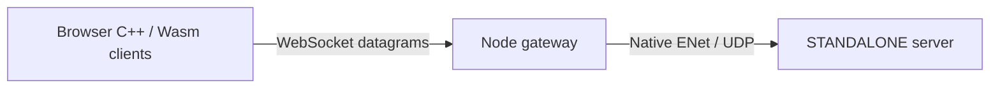

# Outbreak development workflow

This is the verified local workflow as of T0734.6/D065 (8 November 2026). The full browser **network build and published-file verification** are accepted in [D064](../notes/decisions/D064-network-artifact-acceptance.md); the linked network game itself has not been instantiated in a browser. Actual two-client game execution is still pending T067 review, complete runtime pins and a separate MAIN release. Native normal startup/shutdown and a single-peer ENet transport component have separate accepted evidence. These results do not accept P0, production hosting, Outbreak gameplay authority or the eight-player MVP.

Paths below are repository-relative unless absolute. Recorded checkout: `/Users/jd1/code/apps/outbreak`, base commit `13f0d8eea4822dee5c976661218d022be74342e3` **plus accepted dirty/untracked overlays**. HEAD alone cannot reproduce the candidate. Follow [AGENTS](../AGENTS.md), released tickets and current MAIN decisions; this guide does not release a build or service launch. [The gap review](../notes/reviews/T073-reproducibility-gaps.md) identifies remaining clean-checkout work.

## Architecture and local isolation

The browser runs the real C++ client compiled to Wasm, SDL2 and safe legacy GL emulation. NETWORK_CLIENT uses genuine ENet core with the accepted C/JS WebSocket platform backend; it does not use ENet's Unix socket backend or an embedded server as a multiplayer substitute. A separate Node gateway forwards complete datagrams to the genuine native STANDALONE server. Ordinary native game protocol remains legacy1300; client-reported movement/hits are not the planned Outbreak authoritative simulation.



| Intended controlled topology | Address / policy |
| --- | --- |
| Static browser origin | `http://127.0.0.1:29866`; owned static server, pinned bundle only |
| Gateway | `ws://127.0.0.1:29865/enet`, subprotocol `outbreak-enet-dgram.v1` |
| Native upstream | UDP `127.0.0.1:29863`; ancillary native UDP29864 and28762 also reserved/observed |
| Boot/admission | Supervisor supplies immutable `OUTBREAK_NETWORK_BOOT`: schema1, runId, fixed endpoint, canonical16-byte capability; no query/console state injector |
| Ownership | Separate browser/context/Module profiles; single-use capabilities, fixed origin/target, bounded queues/deadlines and owned cleanup; no public listener/master registration/account credentials |

The gateway may admit the browser's standard compression offer while negotiating no compression. Its implementation is `transport/gateway.cjs`, limits in `transport/gateway-limits.cjs`, using vendored `transport/vendor/ws-8.21.0`. Backend API and lifecycle bounds are frozen in [platform0.2](../MVP/EXPERIMENTAL_BROWSER_BACKEND.md), [client0.3](../MVP/EXPERIMENTAL_NETWORK_CLIENT.md) and [main0.1](../MVP/EXPERIMENTAL_NETWORK_MAIN.md). No public/hostile-input safety claim follows from trusted loopback proofs; native reassembly/untrusted-map hardening remains open.

## Recorded prerequisites

These are evidence versions, not an instruction to install latest packages or a production support matrix.

| Component | Recorded version / exact location |
| --- | --- |
| Development host | macOS26.5.1 build25F80, Darwin25.5.0, arm64 |
| Python |3.11.9; `/Library/Frameworks/Python.framework/Versions/3.11/bin/python3`; browser build records resolved `python3.11` in that directory |
| Emscripten |7.0.0 under `/private/tmp/outbreak-web-sdk/upstream/emscripten`; compiler commit `777e6e5db7b4990bcaeb1b9998ed642cc84e6629` |
| SDK release identity | `6afbd83493d647051772d491124187d4e9a0cda9`; distinct from compiler commit and archive hash |
| Build/gateway Node |24.19.0; `/private/tmp/outbreak-web-sdk/node/24.19.0_64bit/bin/node`; SHA `27db838bb204ef7c21df2931f5656e4c8fb32e6e947f363a402b49714d32b5b1` |
| Native compiler / SDK | Apple clang17.0.0 (`clang-1700.0.13.5`), `/Library/Developer/CommandLineTools/usr/bin`; `.../SDKs/MacOSX15.5.sdk` |
| Browser evidence | Chrome156.0.8078.80 at `/Applications/Google Chrome.app/Contents/MacOS/Google Chrome`; component evidence only for this network candidate |
| Browser automation | Playwright1.62.1 at `/Users/jd1/.cache/codex-runtimes/codex-primary-runtime/dependencies/node/node_modules/playwright/index.js`; matching playwright-core is also pinned |

Web ports are SDL2 **2.32.10**, SDL2_image **2.6.0** with PNG only, libpng **1.6.59**, zlib **1.3.2**, Vorbis **1.3.7**, Ogg **1.3.5**. Exact archive SHA512/recipe SHA256 records are in [SDK inspection](build/sdk-inspection/sources-and-artifacts.json) and the [actual result](build/generated/t066/attempt-T070-1/result.json), including libpng. OpenAL/GL support comes from the SDK, not host frameworks. Native server instead uses copied SDL2 framework **2.0.14** with nested hidapi framework metadata1.0, plus system libc++/zlib/pthread/libSystem.

SDK setup was actually performed under D005/T026 using inspected manager commit `1693ce7359fc9694f198694f902a2cc061239b86`, explicit Node/release component install and local activation, existing Python, and no full meta-package/npm/bootstrap/global-shell setup. Exact executed argv/environment/log references: [setup-commands.json](build/generated/t026/setup-commands.json). Binary archives were confined/member-validated; locally measured SHA256 values are [SDK archive](build/generated/t026/sdk-archive.json) `6912ef524fc1173c2b60cd454b04a2e74160c09df73caeb6efc63c122ff88c57` and [Node archive](build/generated/t026/node-archive.json) `8294b7aa9b03997481c06babf1e8b270c859358f27da57a11509afe537ac381d`. Those are local integrity identities, not publisher signatures. The older [inspection report](build/sdk-inspection/REPORT.md) describes the reviewed sources/download URLs; its “not installed/not authorized” and five-port-only statements are historical. Fresh setup needs a scoped reviewed provisioning release; do not execute its old proposal against the existing SDK. D044/D046 allow only the five exact required SDK alias chains/targets, not arbitrary symlink exceptions.

## Recipes, assets and evidence locations

| Target | Genuine unit inventory / data / output |
| --- | --- |
| NETWORK_CLIENT |53 Makefile CLIENT_OBJS CPP +7 ENet core C +`transport/enet_websocket.c`; omit unix.c; link `enet_websocket.js`. `build/network-out`, actual attempt `build/generated/t066/attempt-T070-1` |
| OFFLINE_MAP audio recipe |53 CPP +8 ENet C including unix.c; exact audio-profile79files388764B/revision1. `build/audio-out` is reserved, not produced by T070 |
| Native lifecycle server |8 SERVER_OBJS CPP with STANDALONE +8 repository ENet C including unix.c, per mode. `server/out-lifecycle/{release,debug}/ac_server`; build ledger `server/lifecycle/build-report.json` |

One shared `build/profile_client.py` implements strict recipes/verifiers; fixed wrappers select a profile. [network-config.json](build/network-config.json) is authoritative for recorded flags: C++ gnu++11/signed-char/O2; C gnu11/signed-char/O2/HAS_SOCKLEN_T; OUTBREAK_NETWORK_CLIENT on both, include transport, accepted JS library. Safe legacy GL (`GL_UNSAFE_OPTS=0`),64MiB initial heap,2MiB stack, growth; no extra undefined-symbol suppression, ASSERTIONS/export-all/thread/SIMD flags. Network shell preserves accepted responsive/status/input hooks with only a truthful title change.

All79 network payload files are independently authored Outbreak proof content with scoped MIT provenance/notices. The chain is original map/font/texture pack → original procedural audio and MD3 models → media permissions → audio-enabled profile → network map derivative. [Network provenance](assets/network-profile/PROVENANCE.md) and [manifest](assets/network-profile/manifest.json) pin `c9ecfa62f7e4ca7111a9d3a23a9c97b906d11399d32f6f312463c6697a3359d7`:388791B, maprevision2, eight FFA starts, five unchanged lights and exact geometry,78 other files unchanged. MINSPAWNS5 was not lowered. Original/offline revision1 packs remain immutable; this is not stock-asset redistribution or final Blackwood/squad deployment balancing.

Published network-out contains four runtime files, build-metadata.json and12 notice files. Notice sources are `build/notices/`. The original cache `build/.cache` stays preserved; the actual attempt owns its copied frozen cache, `objects/`, `logs/`, `tmp/`, `node-cache/` and retained `bundle/`. Child environment uses EM_FROZEN_CACHE=1, explicit SDK/config/cache/ports/Python/temp/Node-cache paths and a minimal PATH. Old `build/out` is a separate offline candidate; do not substitute it for network-out.

## Accepted build history and safe verification

The following commands are **historical invocations, not rerunnable rebuild instructions**. The first refuses its existing attempt/target; the native builder would unlink/overwrite its old output. Do not erase artifacts to make either command run.

```text
python3 -B web/build/build_network_client.py --execute --attempt web/build/generated/t066/attempt-T070-1 --pins /Users/jd1/code/apps/outbreak/notes/decisions/D059-network-build-pins.json --pins-sha256 024f1f3a4f7f7c8175521f25083c1314d29f6d2219266b8731e5a574d3c21211
python3 web/server/lifecycle/build.py
```

T070 compiled61 fresh units and linked successfully; JS syntax/Wasm validation/79 actual data slices passed. Its original external verifier failed because its preservation inventory counted its own17-file new publication. That exit2 stays immutable. T072 separately verifies the full old inventory UNION the exact validated publication, retaining every original object/log/source/notice/metadata check. D064 accepts this build remedy without rewriting history or claiming browser runtime. Bundle ID: `35bad2ff04cdc17df5193ca026969380e7c9dc4176596601972b4af163b90e0a`; all17 file identities are in [D064's accepted artifact record](../notes/decisions/D064-accepted-network-artifact.json).

For an inspected **read-only recheck** of this exact existing artifact, call the accepted method below from the recorded repository root. It writes no receipt and forbids subprocess calls. This is documentation; T073 did not execute it.

```sh
python3 -B - <<'PY'
import hashlib, sys
from pathlib import Path
from unittest.mock import patch
p = Path('web/build/verify_published_network.py').resolve()
assert hashlib.sha256(p.read_bytes()).hexdigest() == 'fce172c094dfcfa32c3951d8d8de4078e7be734ca43edb00c681e0accb619b43'
sys.path.insert(0, str(p.parent))
from verify_published_network import PublishedNetworkRecipe
v = PublishedNetworkRecipe()
with patch.object(v.subprocess, 'run', side_effect=RuntimeError('read-only check')):
    print(v.canonical(v.verify(v.published, v.attempt, v.pins_path, v.PINS_SHA)))
PY
```

The standalone `verify_published_network.py` CLI is different: it writes fixed `generated/t072/actual-verification-1.json` and refuses its already-existing receipt. Do not rerun it over old evidence. Accepted receipt SHA `c6ad3a59ef16f70690215811c36a8574b99f9050c2256e80401fd820fba331f5`; verifier SHA is checked above and is separately accepted, not a retroactive build input. Preserve T070/T072 results and terminal freezes.

A later build needs a new MAIN release, freshly reviewed complete current input/alias/port/protection pins and independently supplied SHA, a new attempt, and an explicitly owned absent output destination. The current recipe has a fixed output and refuses an existing target; it is not a general versioned rebuild manager. MAIN must resolve a new isolated destination/lifecycle under an explicit tooling contract rather than bypass checks or delete accepted network-out. Do not reuse D059 as approval for changed inputs. No bootstrap/download/cache mutation is authorized by this guide.

## Native runs and the pending game baseline

Accepted T045 release/debug binary hashes are `49a1d28a6251213e27464afb36b6d974215c9886045a38d00a9cfe66befb096a` / `df4728a98c5fa1ebc03de88a8549e6dba05a25c4c04310673ded3ba009fa1995`. Runtime rpaths load ONLY the owned `server/deps-signed/SDL2.framework` copy and its nested `Versions/A/Frameworks/hidapi.framework`. Ad-hoc signing repaired copies under D014; original `source/xcode/Frameworks` was preserved. This is development signing, not notarization, OS trust changes or permission to re-sign originals. D052 documents the sole sound.h raw-hash/native410-token equivalence exception; other dependency identities remain strict.

The native ledger records arm64/isysroot/signed-char, C++gnu++11/STANDALONE and Cgnu99; release O3/fomit-frame-pointer, debug O0/g/_DEBUG, linking the copied SDL2 plus system zlib/pthread. Exact dependency/compiler/link argv live in `server/lifecycle/build-report.json`; this differs intentionally from the browser O2 recipe.

`server/startup_lifecycle.py release` and `debug` already ran once under T051; they must not be rerun as smoke commands. They used fresh owned `server/run/T051-*` cwd/config/map/log/private directories, unchanged signed libraries, loopback-c1, no mandatory auth/public master/syslog, bounded PTY output, observed sockets/threads, SIGINT and verified cleanup. Both exited0; [T051 handoff](../notes/handoffs/T051-AI-Director-1.md) and final receipt retain exact argv/config/timings. Its revision1 map/startup test was not a valid DM spawn or multiplayer proof; old shutdown failures remain preserved. T063 later proved one genuine ENet CONNECT/native63-byte receive/disconnect path, not game WELCOME/SPAWN or two-client movement.

Intended next entrypoint: `transport/tests/two-client/T067/supervise.py` with its reviewed observer/policy/ownership files. It is still a preparation candidate, not a launch instruction. Its README's statement that T070/T072 acceptance is pending is now historical; supervisor review, complete runtime pins and separate execution release remain pending. Future staging uses the accepted network revision2 map, unchanged native binary with specifically pinned-c2 parameters, two isolated browsers/capabilities and owned static/gateway/native lifecycle. Do not construct a parallel manual launcher, infer game success from rendered frames/WS OPEN, or run its placeholder --execute example. Actual join/map/spawn/remote movement and media/input/performance/human evidence remain separate requirements; see the gap review.

`build/README.md`, `build/FULL_CLIENT_NEXT.md`, early setup reports and native handoff reproduction blocks are historical sources, not current general launch/rebuild instructions. Their three-object/five-port/41-file/missing-link claims and overwrite behavior must be read in that scope. This guide and D064 identify the current candidate; they do not amend gameplay contracts or release T001/P0.
